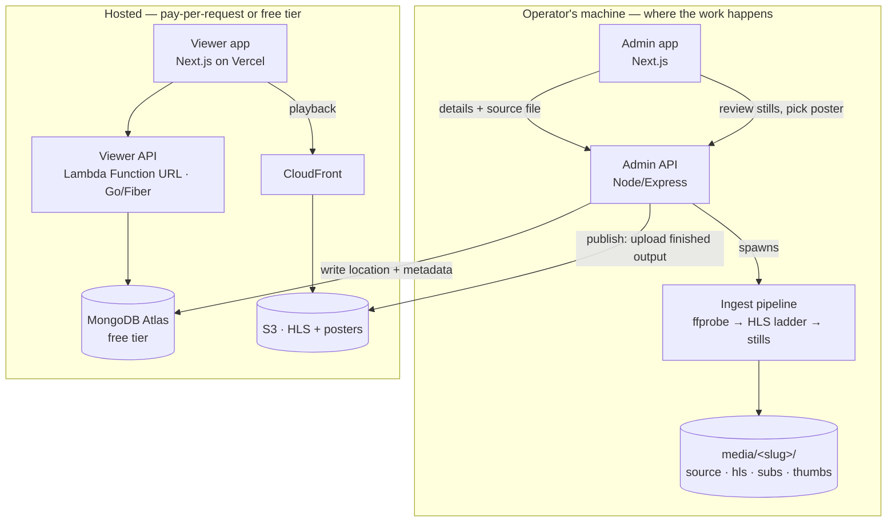

<div align="center">

# CartoonFlix

**A self-hosted streaming platform for animated films and series — engineered to run at roughly the cost of S3 storage.**

[](https://nextjs.org)
[](https://react.dev)
[](https://go.dev)
[](https://nodejs.org)
[](https://mongodb.com/atlas)

[](https://aws.amazon.com/lambda/)
[](https://aws.amazon.com/s3/)
[](https://terraform.io)
[](https://ffmpeg.org)
[](https://tailwindcss.com)
[](https://vercel.com)

`adaptive-bitrate-streaming` · `hls` · `ffmpeg` · `serverless` · `go` · `nextjs` · `terraform` · `aws` · `monorepo`

</div>

---

## The idea

The expensive part of a video service is transcoding. Here it never runs in the cloud.

An operator ingests a title on hardware they already own — probing it, building an adaptive HLS ladder, extracting stills to pick a poster from. Only the finished segments and the chosen artwork are ever uploaded. Nothing in the cloud runs when nobody is watching.

> **Split by cost.** Everything expensive is local. Everything hosted is free-tier or pay-per-request: one Lambda, one Atlas cluster, S3 + CloudFront, and a static frontend on Vercel.

---

## Highlights

| | |
|---|---|
| **Single-pass ABR ladder** | 480p/720p/1080p emitted in one ffmpeg pass via `-filter_complex split` + `-var_stream_map`. The source is decoded once, not once per rendition, and ffmpeg authors the master playlist itself. |
| **Keyframe-aligned renditions** | Fixed GOP with scene-cut detection off, so every rendition cuts at identical timestamps — the precondition for switching quality mid-stream without a stall. |
| **Multi-language audio** | Every audio stream in the source becomes its own HLS rendition in a shared audio group, so a dual-audio release keeps both dubs and the viewer picks. Switching quality no longer re-downloads the audio. |
| **Subtitles** | Embedded text tracks are converted to WebVTT; `.srt`/`.ass`/`.vtt` sidecars can be uploaded. Bitmap tracks (PGS, VOBSUB) are reported as skipped with a reason rather than failing the ingest. |
| **TV remote navigation** | Geometric D-pad focus across the whole site, with a selection box, seek/play/menus inside the player. Enabled only on devices with no pointer. |
| **Series as first-class** | A film is keyed by content id, an episode by `<contentId>/s<N>e<N>`. The same string names the local folder and the S3 prefix, so publishing is a directory copy. |
| **Metadata enrichment** | One click fills synopsis, genres, cast, crew, studios, languages, certification, runtime and artwork from TMDB. |
| **Viewer social** | Accounts, continue-watching across devices, my-list, likes, star reviews, and per-episode comments. |

---

## Architecture



### The ingest pipeline

One command — or one screen in the admin app — takes a source file to a published title.

| Step | What happens | Where |
|---|---|---|
| **Probe** | `ffprobe` reads duration, dimensions, frame rate, and every audio and subtitle stream | local |
| **Transcode** | One ffmpeg pass emits the ladder with a fixed 2s GOP and ~10s segments, plus every audio language and the master playlist | local |
| **Subtitles** | Text tracks become WebVTT; sidecar files can be added afterwards | local |
| **Stills** | Ten frames sampled across the middle 90% of the runtime | local |
| **Review** | The operator picks a poster and a card image | local |
| **Publish** | HLS tree, subtitle tracks and chosen stills go to S3; the location is written to MongoDB | the only cloud write |

**No upscaling.** A 720p source produces 480p and 720p — not a fake 1080p that costs bitrate and adds nothing. A source below the lowest rung is encoded at its own height.

The original event-driven cloud path (S3 event → orchestrator Lambda → SQS → Fargate) still lives in `infra/` and still works. It is the fallback for machines that cannot transcode, not the default.

---

## Repository layout

```
cartoonflix/
├── user-frontend/    # Viewer app — Next.js 15, React 19, Media Chrome player
├── frontend/         # Admin dashboard — Next.js, shadcn/ui, react-hook-form
├── user-backend/     # Viewer API — Go/Fiber, runs as a Lambda or locally
├── admin-backend/    # Content-management API — Node/Express, local only
├── ffmpeg-service/   # Ingest pipeline + publish CLI
├── infra-lambda/     # Terraform for just the viewer Lambda + Function URL
├── infra/            # Terraform for the full event-driven cloud path
└── .github/workflows # CI + deploy
```

---

## Quick start

**Prerequisites** — Node 20+, Go 1.25+, FFmpeg on `PATH` (a static build is bundled as a fallback), a MongoDB connection string, and AWS credentials via `aws configure`.

Each service ships a `.env.example`. Copy it to `.env` and fill it in. `MEDIA_ROOT` **must be the same folder** in both `admin-backend` and `ffmpeg-service`.

### Viewer

```bash
cd user-backend && go run ./cmd
```

```bash
cd user-frontend && npm install && npm run dev -- -p 3002
```

With `NEXT_PUBLIC_API_URL` unset the viewer renders from a bundled sample catalogue, so the UI works with no backend at all.

> Append `?tv=1` to any URL to force TV remote navigation on a desktop browser, and `?tv=0` to force it off. Both are remembered.

### Ingest

```bash
cd admin-backend && npm install && npm run dev
```

```bash
cd frontend && npm install && npm run dev -- -p 3003
```

Then open `http://localhost:3003/admin/new`. A title moves through three tabs:

1. **Details** — type the title, or press **Fill from TMDB** and pick the match. Save to create it; Media and Preview unlock.
2. **Media** — a film gets one ingest panel. A series gets seasons: add one, **Pull episodes from TMDB** to list the whole run, then transcode episodes one at a time. Re-pulling a season refreshes titles and synopses but never touches an episode already transcoded.
3. **Preview** — the title as viewers meet it. Poster and card image can be swapped here without re-running the pipeline.

### The pipeline without the UI

```bash
cd ffmpeg-service && npm install
```

```bash
node src/cli.js ingest --source ./movie.mp4 --content <contentId>
```

```bash
node src/cli.js ingest --source ./ep1.mp4 --content <contentId> --season 1 --episode 1
```

```bash
node src/cli.js publish --content <contentId> --poster 004.jpg --thumbnail 007.jpg
```

A `Makefile` wraps the same commands as `make ingest` / `make publish` where `make` is available.

---

## Configuration

| Service | Variables |
|---|---|
| `user-backend` | `PORT`, `MONGO_URI`, `JWT_SECRET`, `ALLOWED_ORIGINS`, `CLOUDFRONT_KEYPAIR_ID`, `CLOUDFRONT_PRIVATE_KEY` |
| `user-frontend` | `NEXT_PUBLIC_API_URL` — the API base; a bare Function URL is normalised to `/api/v1` automatically |
| `admin-backend` | `PORT`, `MONGO_URI`, `AWS_REGION`, `HLS_BUCKET`, `RAW_BUCKET`, `CLOUDFRONT_DOMAIN`, `TMDB_API_KEY`, `TMDB_REGION`, `MEDIA_ROOT`, `FFMPEG_SERVICE_DIR` |
| `ffmpeg-service` | `AWS_REGION`, `HLS_BUCKET`, `CLOUDFRONT_DOMAIN`, `MEDIA_ROOT` |
| `frontend` | `NEXT_PUBLIC_ADMIN_API_URL` |

AWS credentials are **not** read from `.env` — the SDK uses its default provider chain, so `aws configure` (or an instance role) is the single source. `CLOUDFRONT_DOMAIN` may be given with or without a scheme.

Metadata enrichment needs a free TMDB key. Without it everything still works; the **Fill from TMDB** button simply reports the key is missing and fields are typed by hand.

> TMDB rather than IMDb: IMDb publishes no public API and its terms forbid scraping. TMDB permits this use and carries the IMDb id, so titles can still link out.

---

## Viewer API

Go/Fiber, served from a Lambda Function URL. Payload format 2.0 is identical to an API Gateway HTTP API, so the same binary runs behind either — or locally as a plain server.

| Method | Route | Auth |
|---|---|---|
| `GET` | `/api/v1/health` | — |
| `POST` | `/api/v1/auth/signup` · `/auth/login` | — |
| `GET` | `/api/v1/auth/me` | required |
| `GET` | `/api/v1/contents` · `/contents/:id` · `/content` · `/search` | — |
| `GET` | `/api/v1/contents/:id/social` | optional |
| `POST` | `/api/v1/contents/:id/like` | required |
| `GET` `POST` `DELETE` | `/api/v1/contents/:id/reviews` | read open, write required |
| `GET` `POST` `DELETE` | `/api/v1/contents/:id/comments` | read open, write required |
| `GET` | `/api/v1/me/continue` | required |
| `PUT` | `/api/v1/me/progress` | required |
| `GET` `POST` | `/api/v1/preferences` | required |

Deployment details are in [`user-backend/DEPLOY.md`](user-backend/DEPLOY.md); the Terraform for it is in [`infra-lambda/`](infra-lambda/README.md).

---

## Testing

```bash
cd user-backend && go vet ./... && go test ./...
```

```bash
cd ffmpeg-service && npm test
```

```bash
cd user-frontend && npm run lint && npm test
```

Tests are deliberately narrow and cover the things that broke in production: playlist path separators, the no-upscale ladder, audio-group construction, CloudFront URL assembly, spatial-navigation geometry, API base normalisation, CORS defaults, and IPv6 request handling.

---

## Roadmap

- [x] **Phase 1** — security hardening, monorepo cleanup, key rotation
- [x] **Phase 2** — Terraform infra + CI/CD
- [x] **Phase 3** — serverless API (admin + user Lambdas) + on-demand transcode pipeline
- [x] **Phase 4** — JWT auth, search, observability, admin dashboard, viewer app
- [x] **Phase 5** — local-first ingest: single-pass keyframe-aligned ladder, still extraction and poster selection, series support, publish-to-S3 as an explicit step
- [x] **Phase 6** — TMDB enrichment; admin rebuilt on shadcn + react-hook-form; subtitle extraction and sidecars; Media Chrome player with captions, quality, PiP and 10s skip; likes, reviews, share
- [x] **Phase 7** — watch-page metadata and comments; multi-language audio; TV remote navigation; standalone Lambda Function URL deployment

### Known limitations

- **HLS is served publicly through CloudFront.** Signed URLs cannot work for HLS — the player fetches every segment separately and only the master playlist would carry the signature. Signed *cookies* are the correct fix and need a custom domain so the Vercel app and the distribution share a parent-domain cookie.
- **The admin API has no authentication.** It is designed to run on the operator's machine and must not be exposed; anyone who reaches it can create, edit and delete the entire library.
- **Ingest progress lives in memory.** Restarting the admin server mid-transcode loses the progress bar. The transcode itself continues and the finished job is recovered from its manifest.
- **CloudFront CORS defaults to `*`.** Narrow `allowed_origins` once the viewer has a domain.
- **No review moderation.** One review per account per title is enforced, but nothing screens the text.
- **Titles transcoded before Phase 7 remain single-audio.** They need re-ingesting to gain the language menu.

---

<div align="center">

Built by [Mann Dalsaniya](https://github.com/Mann-webspider)

</div>
