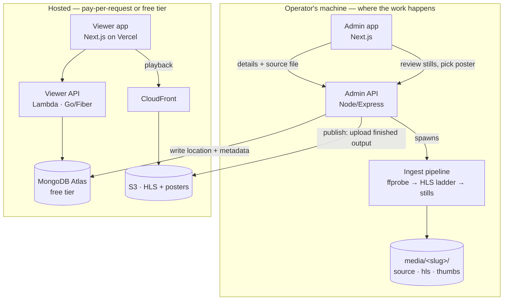

# CartoonFlix

A streaming platform for animated content, built to run at roughly the cost of S3 storage.

The expensive part of a video service is transcoding. Here it happens on hardware you already own: the operator ingests a title on their own machine — probing it, building an adaptive HLS ladder, extracting stills to choose a poster from — and only the finished segments and the chosen artwork are ever uploaded. Nothing in the cloud runs when nobody is watching.

> **Split by cost.** Everything expensive is local. Everything hosted is free-tier or pay-per-request: one Lambda, one Atlas cluster, S3 + CloudFront, and a static frontend on Vercel.

---

## Architecture



### The ingest pipeline

One command, or one screen in the admin app, takes a source file to a published title:

| Step | What happens | Where |
|---|---|---|
| **Probe** | `ffprobe` reads duration, dimensions, frame rate, audio presence | local |
| **Transcode** | One ffmpeg pass emits 480p/720p/1080p with a fixed 2s GOP and ~10s segments, plus the master playlist | local |
| **Subtitles** | Text tracks in the source are converted to WebVTT; sidecar .srt/.vtt files can be added | local |
| **Stills** | Ten frames sampled across the middle 90% of the runtime | local |
| **Review** | The operator picks a poster and a card image from the stills | local |
| **Publish** | HLS tree, subtitle tracks and chosen stills go to S3; the location is written to MongoDB | the only cloud write |

A few details that matter:

- **One pass, not three.** The ladder is built with `-filter_complex split` and `-var_stream_map`, so the source is decoded once instead of once per rendition, and ffmpeg authors the master playlist itself.
- **Keyframes are aligned.** Fixed GOP with scene-cut detection off means every rendition cuts at the same timestamps, which is what lets a player switch quality mid-stream without a stall.
- **No upscaling.** A 720p source produces 480p and 720p — not a fake 1080p that costs bitrate and adds nothing.
- **Series are first-class.** A movie is keyed by its content id; an episode by `<contentId>/s<N>e<N>`. The same string names the local folder and the S3 prefix, so publishing is a directory copy.
- **Bitmap subtitles are reported, not attempted.** Blu-ray PGS and DVD VOBSUB cues are images; converting them needs OCR, so they are listed as skipped with a reason rather than failing the ingest.

The original event-driven cloud path (S3 event → orchestrator Lambda → SQS → Fargate) is still in `infra/` and still works. It is the fallback for machines that cannot transcode, not the default.

---

## Tech stack

- **Frontend:** Next.js (admin dashboard + viewer app), Tailwind, HLS.js
- **APIs:** Node/Express (admin) + Go/Fiber (user) — both deployed as Lambda behind API Gateway
- **Media:** FFmpeg → adaptive-bitrate HLS, delivered via CloudFront signed URLs
- **Data:** MongoDB Atlas (serverless)
- **Messaging:** S3 events + SQS (+ DLQ)
- **Infra:** Terraform (modular) — S3, CloudFront, ECS/Fargate, ECR, Lambda, SQS, API Gateway, IAM
- **CI/CD:** GitHub Actions (lint/test → build/push images → `terraform plan`/`apply`)

---

## Repository layout

```
cartoonflix/
├── frontend/         # Next.js admin dashboard
├── user-frontend/    # Next.js viewer app
├── admin-backend/    # Node/Express content-management API
├── user-backend/     # Go/Fiber viewer API + CloudFront signing
├── ffmpeg-service/   # FFmpeg HLS transcode worker (cloud + local)
├── infra/            # Terraform IaC
└── .github/workflows # CI/CD
```

---

## Running the ingest side

Each service has a `.env.example` — copy to `.env` and fill it in. `MEDIA_ROOT` must be the same folder in both `admin-backend` and `ffmpeg-service`.

```bash
cd admin-backend && npm install && npm run dev
```

```bash
cd frontend && npm install && npm run dev -- -p 3001
```

Then open `http://localhost:3001/admin/new`. One title moves through three tabs:

1. **Details** — type the title, or press **Fill from TMDB** and pick the match. That fills the synopsis, genres, cast, directors, writers, studios, spoken languages, certification, runtime and artwork in one click. Save to create the title; Media and Preview unlock.
2. **Media** — a film gets one ingest panel. A series gets seasons: add a season, **Pull episodes from TMDB** to list the whole run at once, then transcode episodes one at a time. Re-pulling a season refreshes titles and synopses but never touches an episode that has already been transcoded.
3. **Preview** — the title rendered as viewers meet it, on the viewer's own dark billboard. Poster and card image can be replaced from here without re-running the pipeline.

Metadata enrichment needs a free TMDB key in `admin-backend/.env` (`TMDB_API_KEY`). Without it everything still works — the **Fill from TMDB** button just reports that the key is missing, and fields are typed by hand.

> TMDB rather than IMDb: IMDb publishes no public API and its terms forbid scraping. TMDB permits this use and carries the IMDb id, so titles can still be linked out.

The same pipeline is available without the UI:

```bash
cd ffmpeg-service && npm install
```

```bash
make ingest SOURCE=./movie.mp4 CONTENT=<contentId>
```

```bash
make ingest SOURCE=./ep1.mp4 CONTENT=<contentId> SEASON=1 EPISODE=1
```

```bash
make publish CONTENT=<contentId> POSTER=004.jpg THUMBNAIL=007.jpg
```

## Running the viewer side

```bash
cd user-backend && go run ./cmd
```

```bash
cd user-frontend && npm install && npm run dev
```

With `NEXT_PUBLIC_API_URL` unset the viewer renders from a bundled sample catalogue, so the UI works with no backend at all.

## Deploy

The viewer app deploys to Vercel as a static build. Everything else:

```bash
cd infra
```

```bash
terraform init && terraform plan && terraform apply
```

---

## Roadmap

- [x] Phase 1 — security hardening, monorepo cleanup, key rotation
- [x] Phase 2 — Terraform infra + CI/CD
- [x] Phase 3 — serverless API (admin + user Lambdas) + on-demand transcode pipeline
- [x] Phase 4 — JWT auth, search, observability, admin dashboard, viewer app
- [x] Phase 5 — local-first ingest: single-pass keyframe-aligned HLS ladder, still extraction and poster selection, series/episode support, publish-to-S3 as an explicit step; viewer accounts and continue-watching moved into the Go Lambda; viewer app rebuilt
- [x] Phase 6 — TMDB metadata enrichment; admin rebuilt on shadcn + react-hook-form with a real series flow and a preview pane; subtitle extraction and sidecar uploads; Media Chrome player with captions, quality, PiP and 10s skip; likes, reviews and share

### Known limitations

- HLS is served publicly through CloudFront. Signed URLs do not work for HLS — the player fetches every segment separately and only the master playlist would carry the signature. Signed *cookies* are the correct fix and need a custom domain so the Vercel app and the CloudFront distribution can share a parent-domain cookie.
- Ingest progress lives in the admin server's memory, so restarting it mid-transcode loses the progress bar (the transcode itself continues, and the finished job is recovered from its manifest).
- CloudFront CORS defaults to `*`. Narrow `allowed_origins` to the viewer app's origin once it has a domain.
- Review moderation does not exist. One review per account per title is enforced, but nothing screens the text.
